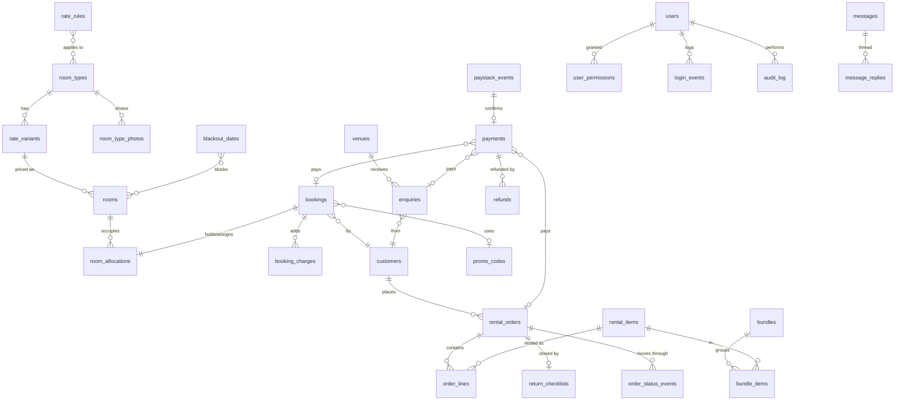

# Hotel A-Wise: production build plan

Status: **approved** by WISDOMSKA(SENYA) on 26 Oct 2026, with D-00 (prototype first), D-01 (pickup only), D-04 (no demos anywhere) and D-11 (manage-booking OTP) confirmed.

Inputs read:
- `design/Handoff.md`
- `design/uploads/2-ATTACH-hotel-a-wise-spec.md`
- all five `.dc.html` prototypes, `store.js` and `support.js`
- the 34 review screenshots in `design/uploads/`
- the image set

Reference renders are in `design/reference-screens/`. They were captured by `scripts/design/capture-reference.mjs` at 1440×900 and 390×844, covering every route, every simulated state, both roles, light and dark.

Source-of-truth order (owner ruling, D-00): **rendered prototypes** → `Handoff.md` → spec → brief. The prototypes were edited after the Handoff was written, so whatever the prototype renders wins. Tokens (colours, type, spacing, motion) are extracted from the prototype source; the Handoff fills gaps the prototype doesn't cover. Conflicts and their rulings are in [DECISIONS.md](./DECISIONS.md) (summarised in §9).

---

## 1. Final stack

| Concern | Choice | Notes |
|---|---|---|
| Framework | **Next.js 16** (App Router, RSC, Server Actions, Route Handlers), TypeScript `strict` | OpenNext's Cloudflare adapter supports every Next 16 minor/patch |
| Runtime and hosting | **Cloudflare Workers** via `@opennextjs/cloudflare`, `nodejs_compat` | Two Workers: `hotel-a-wise` (production) and `hotel-a-wise-preview` (preview), declared as `env.production` and `env.preview` in `wrangler.jsonc` |
| Next cache | `r2IncrementalCache` + `d1NextTagCache` + `doQueue`, following OpenNext's small-site guidance | `revalidateTag()` from admin writes updates the live site. KV is the fallback (eventually consistent, so not preferred) |
| Database | **Neon Postgres** (free), **Drizzle ORM** + `drizzle-kit` migrations | `@neondatabase/serverless`: HTTP driver for one-shot reads, `Pool` over WebSocket (request-scoped) for interactive transactions (`SELECT … FOR UPDATE`, holds). Branches: `main` (prod), `preview`, `ci` (reset each run), and one per PR (optional, free limit is 10) |
| Auth | **Better Auth**: email/password, `twoFactor` (TOTP + backup codes), `admin` plugin for roles and bans, Drizzle adapter | Default hasher is scrypt via `node:crypto` (`nodejs_compat`). Sessions are HttpOnly, Secure, `SameSite=Lax` cookies with a 30-min idle timeout |
| Images | **Cloudinary** (free), signed uploads, custom `next/image` loader, `f_auto,q_auto,c_limit,w_…` | Only public IDs and alt text are stored in Postgres |
| Payments | **Paystack**: Inline v2, channels `mobile_money` + `card`, GHS | Webhook (HMAC-SHA512) plus verify call, Refund API, test keys on preview and live keys on production |
| Email | **Resend** + React Email, from `bookings@hotelawise.com`, reply-to `info@` | Free tier is 3,000/month **and 100/day** (see §8) |
| SMS / WhatsApp | `notify()` with an `ArkeselAdapter` and a `HubtelAdapter`, off unless `SMS_PROVIDER` is set; wa.me click-to-chat links | |
| Rate limiting | **Upstash Redis** + `@upstash/ratelimit` (sliding window) | Covers login, OTP, forms, booking lookups and webhook flood guard |
| Cron | Cloudflare **Cron Triggers** → a `scheduled()` handler wrapped around the OpenNext worker | `*/15 * * * *` expires holds and releases pay-at-pickup orders at 10:00 Accra. `0 7 * * *` sends reminders. `0 2 * * *` runs housekeeping (prunes OTPs and login events past retention) |
| Bot protection | **Turnstile** (managed) on every public form + booking hold creation | Verified server-side |
| Errors | **Sentry** (`@sentry/cloudflare` on the worker, `@sentry/nextjs` client) | PII scrubbed |
| UI | Tailwind CSS v4 (tokens as CSS variables), Radix primitives, Motion, Vaul, Sonner, cmdk, react-hook-form + Zod, TanStack Table, date-fns + `@date-fns/tz`, Recharts (admin only, dynamic import) | Fonts via `next/font/google`: Cormorant Garamond (display), Geist (UI), Geist Mono (see D-07) |
| Tests | Vitest (+ coverage v8), Playwright (Chromium, WebKit, Pixel 7, iPhone 14), axe-core, Lighthouse CI, Playwright visual comparisons, k6 for the concurrency smoke | |
| Tooling | pnpm 10, ESLint (flat, `next/core-web-vitals` + `typescript-eslint` strict), Prettier, Husky + lint-staged + commitlint, Changesets-free `release-please` for semver tags and CHANGELOG | |

**Platform neutrality:** `src/server/services/*` imports no Cloudflare APIs. Bindings (cache, cron, env) are reached only through `src/server/platform/*` adapters, so a move to Vercel or Netlify would only replace that folder.

### 1.1 Free-plan risks, measured before we commit to them

| Limit (Workers Free) | Why we may hit it | Plan |
|---|---|---|
| **3 MiB compressed Worker** | Next 16 runtime + Better Auth + Drizzle + Sentry, with admin and site in one Worker | Measure in M1 (`opennextjs-cloudflare build` prints it). Admin-only libraries go behind `dynamic()`. If we're still over, the options are (a) Workers Paid (10 MiB) or (b) split `/admin` into a second Worker on `admin.hotelawise.com` |
| **10 ms CPU / request** | SSR of dynamic admin pages, and scrypt on sign-in and on password re-prompts | Public pages are cached (ISR + tags), so they're cheap. Sign-in will exceed 10 ms. I won't weaken hashing; I'll report the measured number in M1 |
| R2 needs a payment method on file | Incremental cache | Usage stays well inside R2's free 10 GB. If you'd rather not add a card, KV is the fallback |

**My expectation:** production will need **Workers Paid ($5/month)**, for CPU on sign-in and probably for bundle size. I'll confirm with numbers at the end of M1 before asking you to upgrade.

---

## 2. Repository, branches and CI/CD

- Repo: **`wisdomska/hotelawise`** (private). You chose to use it in place of a new `hotel-a-wise` repo (D-27).
- Branches:
  - `main` is production and deploys to `hotelawise.com`.
  - `preview` is staging and deploys to `preview.hotelawise.com`, behind Cloudflare Access.
  - Feature work goes on `feat/*`, `fix/*` and `chore/*`, with a PR into `preview`.
  - Releases are a PR from `preview` into `main`.
- **Protection on `main` and `preview`:** PR only, required checks, linear history, no force-push, CODEOWNERS review (you). You'll need to apply these rules in GitHub settings, because this session can't change repository settings. I'll give you the exact clicks, or a `gh api` script you can run.
- **Commits:** Conventional Commits, enforced by the `commit-msg` hook. The hook also rejects `Co-Authored-By`, `Claude`, `Anthropic` and `Generated with`.
  - The author is always `WISDOMSKA(SENYA) <102672450+wisdomska@users.noreply.github.com>`.
  - `.claude/settings.json` turns off tool attribution.
  - A CI job re-checks every commit's author, committer and message on each PR, so a commit made outside this machine can't slip through.

### CI (`.github/workflows/ci.yml`, on every PR)
1. `pnpm install --frozen-lockfile` (cached)
2. lint → format check → typecheck
3. unit tests with coverage gates: ≥90% lines/branches on `src/server/services` and `src/lib`
4. integration tests against the Neon `ci` branch (recreated from `main`'s schema each run; test users and fixtures are created by the tests and never reach `preview` or `main`)
5. `opennextjs-cloudflare build` + bundle-size report
6. Playwright e2e + axe + visual regression against the built Worker running in CI (`opennextjs-cloudflare preview`) wired to the `ci` Neon branch, so test accounts never exist on a deployed site
7. `wrangler versions upload --env preview`, which posts the version preview URL as a PR comment for manual review
8. Lighthouse CI (mobile) budgets
9. authorship audit

Separate workflows:
- `codeql.yml`
- `dependabot.yml` (npm + Actions, weekly)
- `deploy.yml`: on push to `preview` or `main`, run `drizzle-kit migrate` against that environment's Neon branch, **then** `wrangler deploy --env <env>`. Migrations never run on page load.

Secrets live in GitHub Actions environments (`preview`, `production`):
- `CLOUDFLARE_API_TOKEN`, scoped to Workers Scripts:Edit, Workers KV/R2/D1:Edit and Account Settings:Read for one account
- `CLOUDFLARE_ACCOUNT_ID`
- `DATABASE_URL_MIGRATE`

Runtime secrets live in `wrangler secret put … --env`.

### Folder structure
As in the brief, with these additions:
- `src/server/platform/` (Cloudflare adapters)
- `src/emails/` (React Email templates)
- `.github/workflows/{ci,deploy,codeql}.yml`

`design/` stays read-only reference, together with `reference-screens/`.

---

## 3. Data model (ERD)

Base: the Handoff model, normalised. All money is `integer` **pesewas**. Stay dates are `date`. Timestamps are `timestamptz` (UTC), shown in `Africa/Accra`. Phones are E.164.



Key tables (columns abbreviated; full DDL goes in `docs/ARCHITECTURE.md` in M1):

- **Rooms:** `room_types(code STD|EXE|VIP|DBL, …)` · `rate_variants(room_type_id, code STD|EXE|EXE_PLUS|VIP|DBL, name, price_pesewas, sleeps)` · `rooms(number, rate_variant_id, status available|occupied|cleaning|maintenance|out_of_order)` · `rate_rules(kind range|weekend|longstay, month_day_from/to, weekdays int[], min_nights, room_type_ids[], direction, unit pct|ghs, amount, active)` · `promo_codes(code citext unique, type pct|ghs|breakfast, value, ends_on, room_type_id null, min_nights, used_count, active)` · `blackout_dates(starts, ends, room_ids[] null=all, reason)`
- **Bookings:** `bookings(ref unique, public_token, customer_id, rate_variant_id, check_in, check_out, guests, arrival_hour, requests, status held|pending_payment|confirmed|checked_in|checked_out|cancelled|no_show|expired, payment_status unpaid|deposit|paid|refunded|partially_refunded, pay_mode full|deposit|at_hotel, source web|phone|walk_in|whatsapp, subtotal, discount, total, promo_code_id, hold_expires_at, notes)` · `booking_charges(kind room|breakfast|room_service|other, qty, unit_pesewas)`
- **No double-booking (database-enforced).** `room_allocations(booking_id, room_id, stay daterange, active bool)` with:
  ```sql
  EXCLUDE USING gist (room_id WITH =, stay WITH &&) WHERE (active)
  ```
  - A hold **is** an allocation (status `held`, `hold_expires_at = now()+15m`), so holds take part in the constraint.
  - Every allocating transaction first runs `UPDATE … SET active=false, status='expired' WHERE hold_expires_at < now() AND stay && $range`. Expired holds therefore never block anyone, whether or not cron has run (D-13).
  - The room is picked inside the same transaction: first free room of the variant, ordered by room number, retried on exclusion violation.
- **Rentals:** `rental_items(name, spec, price_per_day, deposit_per_unit, stock_total, units_in_repair, step, archived, is_custom)` · `rental_item_photos` · `bundles(name, pct_off, active)` + `bundle_items(qty)` · `rental_orders(ref, customer_id, starts, ends, occasion, pay_mode online|at_pickup, pickup_at, return_by, collected_by_name, collected_by_phone, status pending_payment|reserved|ready_for_pickup|collected|returned|completed|cancelled, hold_until, fulfilment pickup|delivery (delivery disabled), delivery_zone_id null)` · `order_lines(item_id, qty, unit_pesewas, deposit_pesewas, days)` · `order_status_events(from, to, reason, by_user_id, at)` · `return_checklists(lines jsonb, deduction, refund, approved_by)` · `delivery_zones(name, fee, active=false)`
- **No overselling:** `create_order` locks the involved `rental_items` rows `FOR UPDATE` (in id order, to avoid deadlocks), recomputes stock per date over `[starts, ends+1]`, then inserts.
- **Venues:** `venues(slug compound|conference, capacity_min/max, hire_pesewas)` · `enquiries(ref, venue_id, event_date, guests, stage new|quoted|deposit_paid|done|lost, quote jsonb, customer_id)`
- **Money:** `payments(ref, booking_id|order_id|enquiry_id (CHECK exactly one), amount, method mtn|telecel|airteltigo|card|cash|pos, channel paystack|desk, paystack_ref unique, status pending|success|failed|reversed, external_txn_id, by_user_id)` · `refunds(payment_id, amount, reason, status pending_approval|processing|refunded|manual_refunded|rejected|failed, paystack_refund_id, manual_txn_id, requested_by, approved_by)` · `paystack_events(event_id unique, type, payload jsonb, signature_ok, processed_at)`
- **People:** `customers(name, phone_e164, email citext, notes, is_repeat generated)` · `guest_otps(ref, channel, code_hash, expires_at, attempts)` · `newsletter_subscribers`
- **Auth (Better Auth tables):** `user(role super_admin|staff, banned)`, `session`, `account`, `verification`, `two_factor`, plus `user_permissions(user_id, key content|reports|inventoryEdit|venueQuotes|exports)` · `login_events(ip, ua, success, at)`
- **Content:** `content_blocks(key, value jsonb)` (home/pages copy with fallbacks) · `image_slots(slot_key, cloudinary_id, alt, original_id)` for the 29 slots · `gallery_items(cloudinary_id, alt, category, position, published CHECK (NOT published OR alt <> ''))` · `faqs` · `testimonials` · `coming_soon(key, now_open, concept_label, replace_before_launch)` · `banner` · `settings(key, value jsonb)`
- **Ops:** `messages` + `message_replies` · `audit_log(user_id, action, entity, entity_id, before jsonb, after jsonb, ip, at)`

**References** (`AW-`, `AWR-`, `EQ-`):
- `nextval()` from a per-prefix Postgres sequence is put through a keyed permutation (Feistel over a 20-bit space, keyed by `REF_SECRET`), then encoded in Crockford base32 with no 0/O/1/I. Example: `AW-7Q3K`.
- They are unique by construction and not enumerable.
- Guest lookups also require phone + OTP.

**Pricing:**
- One pure function, `stayPrice(variant, checkIn, nights, rules, promo?)`, in `src/server/services/pricing.ts`. Its semantics match `store.js`: per-night base ± every rule that hits that night, rules computed on base and additive, floored at 0.
- The client imports the same function for live totals. The server recomputes every total, and the client's figure is never trusted.

---

## 4. Route map

**Public (`(site)`):**

| Route | Cache | Notes |
|---|---|---|
| `/` | ISR, tag `content`, `rooms` | hero exactly as the prototype renders it; the prototype's `night()` logic (Accra hour, 18:00–06:00) is ported client-side where the prototype uses it (D-09) |
| `/rooms` | ISR | filters client-side |
| `/rooms/[code]` | ISR, `generateStaticParams` STD/EXE/VIP/DBL | OG image per room via `opengraph-image.tsx` |
| `/gallery`, `/contact`, `/events` (venues + rentals overview) | ISR | |
| `/book` | dynamic | steps via `?step=` + server-held hold id |
| `/book/confirmation/[token]` | dynamic, noindex | |
| `/manage` | dynamic, noindex | ref + phone → OTP → manage |
| `/rent`, `/rent/checkout`, `/rent/confirmation/[token]` | dynamic | |
| `/venues/enquire` | dynamic | |
| `not-found` | static | "This room doesn't exist. But these do." |
| `sitemap.xml`, `robots.txt` | static | noindex everywhere on preview |

**Admin (`/admin`, noindex, all dynamic):**
- `login` · `login/2fa` · `forgot` · `reset`
- `/admin` (dashboard)
- `bookings` (`?view=list|timeline`) · `rooms` · `rentals` (`?view=list|calendar|pipeline`) · `inventory` · `venues`
- `payments` · `customers` · `reports` · `content` · `inbox` · `settings` · `users` · `audit` · `account`

**API:**
- `POST /api/paystack/webhook`
- `POST /api/uploads/sign`
- `GET /api/ics/[token]` (booking or order)
- `GET /api/health`
- `GET /api/exports/[kind]` (CSV/XLSX, needs the `exports` grant)
- `GET /api/invoices/[ref].pdf`

Most mutations are **Server Actions**. Each action does four things:
1. `requirePermission()`
2. Zod validation
3. A transaction
4. An `audit()` write, followed by `revalidateTag()`

---

## 5. Permission matrix

The server enforces it in **every** action and query through `requirePermission(user, key)`. The sidebar, the palette and the components render from the same map, so a hidden item is also a forbidden one. Direct URLs return **403** (in-app forbidden page).

| Capability key | Super Admin | Staff | Staff + grant |
|---|---|---|---|
| `dashboard.view` / `dashboard.revenue` | ✓ / ✓ | ✓ / ✗ | |
| `bookings.view/create/edit/checkin/checkout/payment.desk/note` | ✓ | ✓ | |
| `bookings.refund` · `bookings.delete` · `refunds.approve` | ✓ | ✗ (staff refunds → *pending approval*) | |
| `rooms.view` · `rooms.status` | ✓ | ✓ | |
| `rooms.types/rates/rules/promos/blackouts/policies.edit` | ✓ | ✗ (read-only view) | |
| `rentals.view/create/status/checklist` | ✓ | ✓ (checklist refund → approval) | |
| `rentals.refund` · `rentals.delete` | ✓ | ✗ | |
| `inventory.view` · `inventory.repair` | ✓ | ✓ | |
| `inventory.edit` (price/deposit/stock/items) | ✓ | ✗ | `inventoryEdit` |
| `venues.view/pipeline` | ✓ | ✓ | |
| `venues.quote` | ✓ | ✗ | `venueQuotes` |
| `payments.*` | ✓ | ✗ | |
| `customers.view/note` · `customers.spend` | ✓ / ✓ | ✓ / ✗ | |
| `reports.view` | ✓ | ✗ | `reports` |
| `exports.download` | ✓ | ✗ | `exports` |
| `content.edit` · `content.delete` | ✓ / ✓ | ✗ | `content` (edit only, never delete) |
| `inbox.*` | ✓ | ✓ | |
| `settings.*` · `settings.keys.reveal` (fresh 2FA ≤5 min) | ✓ | ✗ | |
| `users.*` (never deactivate or demote the last active Super Admin; enforced in SQL too) | ✓ | ✗ | |
| `audit.view` | ✓ | ✗ | |

**Money re-prompt:** every money action (desk payment, refund, refund approval, rental payment, deposit-refunding checklist) requires the current password. On success the action gets a 5-minute signed `step_up` token that is bound to that action only.

**Tests:** `tests/unit/permissions.test.ts` enumerates every (role × grant × capability) cell. An e2e test hits every admin URL as Staff without grants and expects a 403.

---

## 6. Correctness and security (summary; details in ARCHITECTURE/SECURITY)

**Holds**
- A hold is created on leaving step 1 (Turnstile-checked, rate-limited per IP), lasts 15 minutes and is shown as a countdown.
- It counts against availability until `expires_at`. Every query treats an expired hold as expired, so correctness never depends on cron (D-13).

**Webhook-only confirmation**
1. Verify the HMAC signature.
2. Insert into `paystack_events` with `ON CONFLICT DO NOTHING`.
3. Call `GET /transaction/verify/:ref` and compare amount + currency + metadata.
4. In one transaction, re-check the allocation, mark the payment successful and confirm the booking.

**Late payment after hold expiry**
- If the room or stock is still free, re-allocate and confirm.
- Otherwise call the Paystack refund automatically, email the guest and alert staff (D-15).

**Refunds**
- Paid through the Paystack Refund API. Support for each channel (MoMo per network, card) is verified in test mode during M3.
- An unsupported channel becomes `manual_refunded` with a transaction ID. A staff-initiated refund goes to `pending_approval`.

**Security**
- Strict CSP with nonces, HSTS preload, `frame-ancestors 'none'`, Referrer-Policy and Permissions-Policy.
- Better Auth's CSRF/origin checks, plus same-origin checks on Server Actions.
- Rate limits on login (5 attempts, then a 30 s lock, per Handoff), OTP, forms and lookups. Turnstile on public forms.
- Upload URLs are signed. Secrets are revealed only after fresh 2FA.
- **No demo accounts and no "Reset demo data" on any deployed site, production or preview** (D-04). On each environment, the first Super Admin comes from `scripts/create-super-admin.ts`, which reads `SUPER_ADMIN_EMAIL` and `SUPER_ADMIN_TEMP_PASSWORD` and forces a password change plus TOTP enrolment on first login. Staff are invited from Users & permissions.
- Both environments are seeded with the real catalogue only (rooms, rates, venues, rental items, content, photos). No fake guests, bookings or revenue.
- The OWASP ASVS L2 checklist is tracked in `docs/SECURITY.md`.

---

## 7. Milestones (each goes to `preview` first, then `main` once green)

1. **Foundations:**
   - CI/CD, both Workers, Neon branches, domain and DNS (with your approval), tokens, fonts, layout shell
   - Better Auth + 2FA + roles + `requirePermission`
   - full schema + migrations, seed, Cloudinary image import with renames and alt text
   - **bundle-size and sign-in CPU measurements** → Workers plan decision
2. **Public site:** pixel match on every page and state, with content from the DB and visual tests against `reference-screens`.
3. **Room booking:** holds, Paystack, webhook, confirmation + .ics, manage booking with OTP, emails.
4. **Rentals, venues and enquiries.**
5. **Admin:** all 14 screens + sign-in, 2FA, reset, account, ⌘K, dark mode, idle timeout; the full permission matrix and the audit log.
6. **Notifications, cron, reports and exports:** notifications, the `scheduled()` jobs, reports, CSV/XLSX exports, PDF invoices.
7. **Release:** full QA (`docs/QA-REPORT.md`), security pass, performance tuning, `docs/RUNBOOK.md`, release `v1.0.0`.

Each milestone ends with a short summary, the preview URL, test results and blockers.

---

## 8. What I need from you (asked for at the milestone that needs it)

| When | Item |
|---|---|
| Now | ✅ Git identity (done). ✅ Repo choice (done). **Approval of this plan and the questions in §10.** |
| M1 | **Cloudflare:** account ID + a *new* API token (the one pasted in chat must be revoked, see the note below). Add it as GitHub Actions secret `CLOUDFLARE_API_TOKEN` yourself, or put it in this environment's secrets so it never appears in chat. Also confirm R2 (needs a payment method on file) or accept the KV fallback. |
| M1 | **Neon:** a project in region `aws-eu-central-1` (Frankfurt, the closest to Accra on Neon), plus connection strings for `main` and `preview`. |
| M1 | **Domain:** registrar access for `hotelawise.com`. Before any nameserver change, I'll export the current DNS (MX for `info@`) and show it to you for approval. |
| M1 | **Cloudinary:** cloud name + API key/secret. **Sentry:** DSN. **Upstash:** REST URL/token (×2 envs). **Turnstile:** site + secret key (×2). |
| M1 | **GitHub settings:** apply branch protection (I'll provide the script), and add the Actions secrets. |
| M3 | **Paystack** test keys (public + secret). **Resend** API key + domain verification. |
| M7 | Paystack **live** keys (after business verification). Optional: Arkesel/Hubtel key + registered sender ID. A decision on Workers Paid ($5/month). |

**Security notice:** the GitHub PAT and Cloudflare token pasted into this conversation should be treated as exposed. Please **revoke both now** and create fresh ones.
- This session doesn't need the PAT: it already has scoped GitHub access.
- Deliver the new Cloudflare token through GitHub Actions secrets or the cloud environment's secret settings, not chat.

**Free-tier ceilings to know:**
- Resend: 100 emails/day. That's fine at this size, but the reminder batch is throttled.
- Neon: 0.5 GB storage per project.
- Upstash: 500k commands/month.
- Sentry: 5k errors/month.
- Cloudflare Access: free up to 50 users.

---

## 9. Conflict log (summary; full entries in DECISIONS.md)

| # | Conflict | Ruling |
|---|---|---|
| D-01 | Checkout prototype has delivery, zones, `#track` | Pickup only, no tracking page; zones kept in the model, disabled (owner ruling, reconfirmed) |
| D-02 | "Reminder the day before delivery" | Read as **pickup** (ruling 2) |
| D-03 | Spec bundles with delivery/setup fees | Bundles kept, delivery dropped, setup only on venue quotes (ruling 3) |
| D-04 | Demo login `admin@123`, "Reset demo data" | Removed everywhere: not on production, not on preview (owner ruling) |
| D-05 | Vercel/Supabase in docs | Cloudflare Workers + Neon + Cloudinary (ruling 5) |
| D-06 | Rental order statuses (spec: delivery stages) | Handoff stages: Reserved → Ready for pickup → Collected → Returned → Completed |
| D-00 | Handoff vs prototype | **Prototype wins** (owner ruling) |
| D-07 | **Heading font:** Handoff says Newsreader; the prototypes use **Cormorant Garamond** throughout | Cormorant Garamond (prototype) |
| D-08 | **Hero copy:** prototype/CMS seed "Your gateway to unforgettable memories" vs spec ban on "unforgettable memories" and its "Arrive at 3am…" line | Prototype copy, CMS-editable |
| D-09 | **Night/day hero:** Handoff requires a separate night hero; the prototype renders the same photo hero by day and night | Prototype: one photo hero; its `night()` details ported as-is |
| D-10 | Executive Plus is a separate code `EXE+` in prototype data | Stored as a rate variant of EXE; shown as `EXE+` / "Executive Plus" exactly where the prototype shows it |
| D-11 | Manage booking: Handoff says ref + phone; brief adds OTP | Add OTP (safer, prevents lookup by guessed ref + known phone) |
| D-12 | Pay-at-hotel "Confirmed – unpaid" isn't a Handoff status | `status=confirmed` + `payment_status=unpaid` |
| D-13 | Holds per rate variant (Handoff) vs DB-enforced per-room exclusion | A hold allocates a concrete room inside the constraint; expired holds are lazily deactivated in the same transaction |
| D-14 | Rental payment: spec "deposit or full"; Handoff "online full incl. refundable deposit, or pay at pickup"; seed "rental deposit 50%" | Prototype: pay online in full incl. refundable security deposit, or pay when you collect. No 50% option |
| D-15 | Late payment after hold expiry | Confirm if still free, else auto-refund + email + staff alert |
| D-16 | Rental status notifications "SMS" | Email at every step; SMS when the adapter is on |
| D-17 | Reference screenshots flag fixes | All kept fixed (list in DECISIONS.md D-17) |
| D-18 | Contact numbers: spec reception +233 55 555 7090; the old site footer shows +233 54 012 0400 as main | Spec values seeded and editable in Settings. **Confirm with the hotel** |
| D-20 | ⌘K palette animation | Prototype motion kept |
| D-21 | Admin dark palette: Handoff navy `#07072B` vs prototype neutral black | Prototype tokens (`#111113` / `#1A1A1D` / `#EDEDEF`…) |
| D-27 | Brief asks for repo `hotel-a-wise` | You chose `wisdomska/hotelawise` |

---

## 10. Questions before I start (defaults apply if you just say "approved")

Q1–Q3 (font, hero headline, rental payment) are settled by the prototype-first ruling.

- **Q4 Workers Paid ($5/month):** OK to switch if the M1 measurements show sign-in or bundle size over the free limits? (default: I stop and ask with numbers)

## 11. Confirm with the hotel (all editable in Settings; seeded as below)

- **Room numbers:** STD 101–106, DBL 107–108, EXE 201/202/205, EXE Plus 203/204, VIP 206–208 (16 rooms)
- **Times and fees:** breakfast GHS 50 per guest per day; room service fee GHS 20; check-in 14:00, check-out 12:00
- **Policies:** free cancellation more than 48 h out; deposit 30%; no-show is charged the first night
- **Rental prices per day (GHS):** canopy 250, long table 40, short table 25, foldable chair 5, regular chair 3, tablecloth 15, chair cover 4. Security deposits are per item. Packs are 8–10% off.
- **Venue hire for quotes:** compound GHS 2,500, conference room GHS 800. Setup GHS 150 (venues only).
- **Phone numbers:** primary and alternates (D-18)
- **Missing photo:** regular plastic chair. **Replace before launch:** Summer Hut concept image (shows a pool A-Wise doesn't have).
